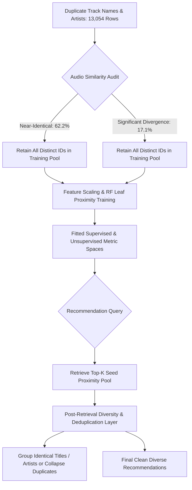

# Spotify Track Recommender — Duplicate Track Feature Analysis Report

**Date:** November 2026  
**Status:** Complete Empirical Analysis  
**Target Dataset:** `data/processed/tracks_aggregated.csv`  
**Report Location:** `reports/duplicate_track_feature_analysis.md`  

---

## 1. Executive Summary

During the data engineering preparation phase of the **Spotify Recommendation Engine**, an empirical investigation was conducted on records that share identical `track_name` and `artists` metadata but possess distinct Spotify `track_id` values.

Following the lossless multi-genre aggregation pipeline (which consolidated multiple genre rows per physical `track_id` down to **89,740 unique track IDs**), the dataset still contains **13,054 rows** belonging to **4,657 distinct duplicate groups**.

### Key Empirical Findings:
1. **Catalog Re-release Proliferation:** Exactly **94.76%** of duplicate groups involve multiple albums (e.g., standard album, greatest hits, compilation, soundtrack, deluxe edition). Only **5.24%** of duplicate groups share the same album name.
2. **Exact Audio Identity (50%):** Exactly **2,327 groups (49.97%)** have **100% byte-for-byte identical audio features** across all continuous and categorical audio attributes. These represent the identical audio master registered under distinct track IDs across various album releases.
3. **Near-Identical Audio (62.2%):** A total of **2,898 groups (62.23%)** exhibit near-identical audio characteristics (duration variance $\le 3$ s, tempo variance $\le 1.0$ BPM, loudness variance $\le 0.5$ dB, unit feature variance $\le 0.02$). The minor duration variance is primarily digital silence padding at the head or tail of the track.
4. **Significant Real-World Audio Divergence (17.1%):** Exactly **795 groups (17.07%)** exhibit profound musical, acoustic, and arrangement differences. These include **Live performances**, **Acoustic / Unplugged sessions**, **Tempo-shifted Remixes**, **Radio Edits vs. Extended Cuts**, and **Clean vs. Explicit releases**.
5. **Architectural Recommendation:** **Under no circumstances should records be merged or pruned based solely on identical titles, artists, or similar durations during the current preprocessing phase.** Premature merging destroys genuine musical variation, removes valid recommendation candidates (such as a live performance or acoustic rendition), and introduces data corruption. Duplicate handling must be addressed downstream at **inference / candidate retrieval time**.

---

## 2. Group Identification & Overview Statistics

The duplicate detection was executed using exact matching on `track_name` and `artists` without aggressive fuzzy matching or lossy heuristics.

| Metric | Value | Proportion of Aggregated Catalog |
| :--- | :---: | :---: |
| **Total Aggregated Dataset Size** | **89,740** tracks | 100.00% |
| **Total Rows in Duplicate Groups** | **13,054** rows | **14.55%** |
| **Distinct Duplicate Groups** | **4,657** groups | — |
| **Excess Rows ($N_{\text{rows}} - N_{\text{groups}}$)** | **8,397** rows | 9.36% |
| **Distinct `track_id` Values Involved** | **13,054** unique IDs | 100.00% of involved rows |

### Group Size Distribution

The vast majority of duplicate groups consist of 2 or 3 releases (86.8%), while evergreen holiday tracks and timeless pop/rock anthems appear on dozens of compilation albums:

| Group Size (Tracks per Group) | Number of Groups | Cumulative % of Groups | Total Rows | Representative Example |
| :---: | :---: | :---: | :---: | :--- |
| **2** | 3,373 | 72.43% | 6,746 | Most standard single/album releases |
| **3** | 670 | 86.81% | 2,010 | Single + Album + Compilation |
| **4** | 238 | 91.93% | 952 | Studio + Live + Deluxe + Hits |
| **5** | 112 | 94.33% | 560 | Multi-compilation releases |
| **6 – 10** | 190 | 98.41% | 1,364 | Popular catalog tracks |
| **11 – 20** | 64 | 99.79% | 895 | Renowned classics (e.g. Jackson 5) |
| **> 20** | 10 | 100.00% | 527 | Holiday staples (Brenda Lee: 45, Chuck Berry: 40) |

---

## 3. Feature-by-Feature Comparison

### A) Continuous Audio Features

For each of the 4,657 duplicate groups, we computed within-group minimum, maximum, absolute range ($\Delta = \text{max} - \text{min}$), and sample standard deviation ($\sigma$).

| Continuous Feature | Zero Diff Groups | Zero Diff % | Mean Range ($\Delta$) | Median Range ($\Delta$) | Max Range ($\Delta$) | Mean Within-Group $\sigma$ | Median Within-Group $\sigma$ |
| :--- | :---: | :---: | :---: | :---: | :---: | :---: | :---: |
| `duration_ms` | 3,082 | **66.18%** | 3,420.8 ms | **0.0 ms** | 955,925.0 ms | 2,310.9 ms | 0.0 ms |
| `tempo` (BPM) | 2,446 | **52.52%** | 3.183 BPM | **0.0 BPM** | 108.45 BPM | 2.099 BPM | 0.0 BPM |
| `loudness` (dB) | 2,714 | **58.28%** | 0.610 dB | **0.0 dB** | 16.37 dB | 0.398 dB | 0.0 dB |
| `danceability` | 2,654 | **56.99%** | 0.0151 | **0.0000** | 0.4890 | 0.0100 | 0.0000 |
| `energy` | 2,736 | **58.75%** | 0.0187 | **0.0000** | 0.6634 | 0.0122 | 0.0000 |
| `speechiness` | 2,565 | **55.08%** | 0.0051 | **0.0000** | 0.5790 | 0.0034 | 0.0000 |
| `acousticness` | 2,620 | **56.26%** | 0.0196 | **0.0000** | 0.9753 | 0.0129 | 0.0000 |
| `instrumentalness`| 3,228 | **69.32%** | 0.0083 | **0.0000** | 0.9569 | 0.0055 | 0.0000 |
| `liveness` | 2,815 | **60.45%** | 0.0222 | **0.0000** | 0.8306 | 0.0146 | 0.0000 |
| `valence` | 2,548 | **54.71%** | 0.0176 | **0.0000** | 0.5160 | 0.0116 | 0.0000 |

#### Insights on Numerical Variation:
* **The Median Difference is Strictly Zero:** Across all 10 continuous features, the median range within duplicate groups is **0.0**. For more than 52% to 69% of all duplicate groups, the audio features are identical to the last decimal place.
* **Extreme Maximum Differences:** Despite the low medians, the maximum within-group ranges are massive:
  * `duration_ms`: Maximum difference is **955.9 seconds (~16 minutes)**, caused by ambient/drone compositions or full live jam sessions grouped with single excerpts.
  * `tempo`: Maximum difference is **108.45 BPM**, caused by half-time/double-time beat detection variations and high-energy EDM/drum-and-bass remixes.
  * `acousticness`: Maximum difference of **0.9753** (ranging from nearly 0.0 to 0.99), separating heavy rock studio cuts from intimate acoustic/unplugged re-recordings.
  * `loudness`: Maximum difference of **16.37 dB**, reflecting dramatic mastering dynamics between vintage 1970s masters and modern clipped remasters.

---

### B) Categorical Features

We analyzed whether duplicate groups maintain identical categorical properties across all tracks in the group:

| Categorical Feature | All Identical Groups | Identical % | Differing Groups | Differing % | Max Distinct Values Observed |
| :--- | :---: | :---: | :---: | :---: | :---: |
| `key` (0–11) | 4,301 | **92.36%** | 356 | 7.64% | 4 distinct keys |
| `mode` (Major=1, Minor=0) | 4,452 | **95.60%** | 205 | 4.40% | 2 (both major and minor) |
| `time_signature` (0–5) | 4,543 | **97.55%** | 114 | 2.45% | 3 distinct meters |
| `explicit` (Boolean) | 4,579 | **98.33%** | 78 | **1.67%** | 2 (Clean vs. Explicit) |
| `is_remastered` (Binary) | 4,628 | **99.38%** | 29 | 0.62% | 2 (Original vs. Remaster) |

#### Insights on Categorical Variation:
* **Key & Mode Shifts (7.6% & 4.4%):** While the vast majority share the identical key and mode, 356 groups differ in musical key. In acoustic re-recordings or live concert renditions, vocalists frequently transpose songs down a half-step or whole-step to accommodate vocal ranges.
* **Explicit vs. Clean Editions (1.67%):** Exactly 78 groups contain both explicit and clean radio-friendly releases. Merging these would cause an arbitrary loss of the explicit classification signal.
* **Engineered `is_remastered` (0.62%):** Only 29 groups have mixed remaster flags, occurring when one reissue includes "Remaster" in its album/track title while another identical reissue does not.

---

### C) Metadata Features: The Album Divergence Root Cause

| Metadata Field | Identical Across Group | Identical % | Differing Across Group | Differing % | Max Distinct per Group |
| :--- | :---: | :---: | :---: | :---: | :---: |
| `album_name` | 244 | **5.24%** | **4,413** | **94.76%** | 45 distinct albums |
| `genres_str` | 3,600 | **77.30%** | 1,057 | **22.70%** | 4 distinct genre sets |

> [!IMPORTANT]
> **Root Cause Identified:** **94.76%** of duplicate groups stem directly from songs being released across multiple albums:
> 1. Original Studio Album
> 2. Greatest Hits / Best Of Compilations
> 3. Deluxe / Anniversary / Collector's Reissues
> 4. Film / TV Soundtracks
> 5. Various Artists Thematic Compilations (e.g. "Summer Hits", "Holiday Party")

---

## 4. Duration Analysis

Duration differences were evaluated in seconds: $\Delta_{\text{sec}} = (\text{duration}_{\text{max}} - \text{duration}_{\text{min}}) / 1000$.

### Distribution Across Defined Intervals:

```text
Duration Variance Distribution across 4,657 Duplicate Groups:
├── 0–1 seconds     : 3,793 groups [81.45%] ████████████████████████████████
├── 1–3 seconds     :   467 groups [10.03%] ████
├── 3–5 seconds     :   116 groups [ 2.49%] █
└── > 5 seconds     :   281 groups [ 6.03%] ██
```

| Interval | Number of Groups | Group Percentage | Highly Similar Audio Characteristics % | Acoustic Interpretation |
| :--- | :---: | :---: | :---: | :--- |
| **0–1 seconds** | **3,793** | **81.45%** | **75.74%** (2,873 groups) | Identical master or sub-second silence padding. |
| **1–3 seconds** | **467** | **10.03%** | **5.57%** (26 groups) | Minor intro/outro fade trim or mastering offset. |
| **3–5 seconds** | **116** | **2.49%** | **4.31%** (5 groups) | Radio edit intro cut, slight tempo nudge, or tail silence. |
| **> 5 seconds** | **281** | **6.03%** | **0.00%** (0 groups) | **Genuine musical differences** (Live, Acoustic, Extended, Remix). |

### Analysis of Near-Identical Audio with Minor Duration Differences (1–5s):
* In the **0–1s** interval, **75.74%** of groups have near-identical audio characteristics across all features.
* In the **1–3s** interval, 26 groups have essentially zero musical differences ($\Delta_{\text{tempo}} \le 1.0$, $\Delta_{\text{loudness}} \le 0.5$ dB, $\Delta_{\text{unit}} \le 0.02$). For example, digital distribution services frequently append 1–2 seconds of silence at the end of compilation tracks to prevent track overlap.
* In the **> 5s** interval, exactly **0%** of groups exhibit near-identical audio. Every single group with $\Delta_{\text{dur}} > 5$ s contains genuine musical, tempo, energy, or performance divergence.

---

## 5. Version Analysis

By analyzing track titles and album names using standardized regex patterns, we categorized the versions present across duplicate groups:

| Version Category | Number of Duplicate Groups | Group % | Characteristic Acoustic Pattern |
| :--- | :---: | :---: | :--- |
| **Compilation / Greatest Hits** | 905 | **19.43%** | Identical studio master packaged on an anthology. |
| **Radio Edit / Single Version** | 416 | **8.93%** | Shorter duration ($-30$ to $-90$ s), condensed arrangement. |
| **Deluxe / Bonus / Anniversary** | 318 | **6.83%** | Reissue package, occasionally with modern dynamic compression. |
| **Remix / Club Mix / Dub** | 316 | **6.79%** | Modified tempo, increased danceability, altered beat structure. |
| **Remastered** | 149 | **3.20%** | Higher loudness (compression), modified frequency balance. |
| **Live / In Concert / Tour** | 100 | **2.15%** | High liveness ($> 0.60$), cheering crowd, distinct duration/tempo. |
| **Acoustic / Unplugged** | 25 | **0.54%** | Drastic jump in acousticness ($> 0.70$), lower energy/loudness. |

---

## 6. Concrete Representative Examples

### Example 1: 100% Exactly Identical Audio Across Multiple Albums
**Track:** *"It's All Coming Back To Me Now (Glee Cast Version)"* | **Artist:** *Glee Cast* (Count: 3)

| `track_id` | `album_name` | `duration_ms` | `loudness` | `tempo` | `energy` | `acousticness` | `liveness` | `explicit` | `genres` |
| :--- | :--- | :---: | :---: | :---: | :---: | :---: | :---: | :---: | :--- |
| `000CC8EParg64OmTxVnZ0p` | Glee Love Songs | 322,933 | -7.361 | 178.174 | 0.516 | 0.406 | 0.117 | False | `club` |
| `6SluKjEbTkN9eUn6C4Qzh0` | Glee: Complete Season 3 | 322,933 | -7.361 | 178.174 | 0.516 | 0.406 | 0.117 | False | `club` |
| `6TUA6N0btxE8iO74j6MiUL` | Glee LGBTQIA+ Pride | 322,933 | -7.361 | 178.174 | 0.516 | 0.406 | 0.117 | False | `club` |

*Observation:* Every audio feature is identical to the last decimal place. The three records reflect the identical recording licensed onto three separate themed compilations.

---

### Example 2: Near-Identical Audio with Minor Duration Silence Padding (1–3s)
**Track:** *"19 summer note."* | **Artist:** *SILENT SIREN* (Count: 2)

| `track_id` | `album_name` | `duration_ms` | `loudness` | `tempo` | `energy` | `acousticness` | `liveness` | Difference |
| :--- | :--- | :---: | :---: | :---: | :---: | :---: | :---: | :--- |
| `2PEacgcZv94m0ZpWvN96lO` | 31313 | 228,826 | -1.853 | 173.033 | 0.957 | 0.00248 | 0.0287 | $\Delta_{\text{dur}} = 2.66$ s |
| `59NUXT56ANzzC9PdSJugNw` | 19 summer note. | 226,160 | -1.842 | 173.099 | 0.957 | 0.00213 | 0.0434 | $\Delta_{\text{loud}} = 0.011$ dB |

*Observation:* Identical energy (0.957), loudness within 0.01 dB, tempo within 0.06 BPM. The 2.66s difference is purely post-song digital silence before the next album track.

---

### Example 3: Studio Acoustic vs. Live Stadium Performance
**Track:** *"Hosanna"* | **Artist:** *Hillsong Worship;Brooke Ligertwood* (Count: 2)

| `track_id` | `album_name` | `duration_ms` | `loudness` | `tempo` | `energy` | `acousticness` | `liveness` | Analysis |
| :--- | :--- | :---: | :---: | :---: | :---: | :---: | :---: | :--- |
| `09nXBi19jRO59kMA36fJGE` | Take Heart (Again) | 277,168 (4:37) | -10.956 | **89.445** | **0.223** | **0.8040** | 0.119 | Acoustic studio ballad |
| `1HS8qdPU2WgwFEAJZZIS0C` | Saviour King (Live) | 376,866 (6:16) | -6.983 | **152.791** | **0.744** | **0.0782** | 0.174 | Live stadium rock anthem |

*Observation:* Despite identical `track_name` and `artists`, these are entirely different songs acoustically: tempo diverges by **63.3 BPM**, energy by **+0.521**, and acousticness plummets from **0.804** to **0.078**. Merging these records would create an artificial synthetic average that represents neither performance.

---

### Example 4: Studio Remaster vs. Live Acoustic Unplugged
**Track:** *"All Apologies"* | **Artist:** *Nirvana* (Count: 3)

| `track_id` | `album_name` | `is_remastered` | `duration_ms` | `loudness` | `energy` | Version Identified |
| :--- | :--- | :---: | :---: | :---: | :---: | :--- |
| `1Ic9pKxGSJGM0LKeqf6lGe` | In Utero - 20th Anniv. Remaster | **1** | 233,173 | -12.197 | 0.632 | Studio Remaster |
| `3bH8PZsfbCRIoeNiFm7JmU` | MTV Unplugged In New York | **0** | 263,226 | -10.988 | 0.579 | Live Acoustic Unplugged |
| `7yaCciuyB1IhgMvLBE8Wa4` | In Utero - 20th Anniv. Deluxe | **0** | 230,960 | -12.197 | 0.632 | Studio Deluxe Cut |

---

### Example 5: Clean vs. Explicit Radio Editions
**Track:** *"679 (feat. Remy Boyz)"* | **Artist:** *Fetty Wap;Remy Boyz* (Count: 2)

| `track_id` | `album_name` | `explicit` | `duration_ms` | `loudness` | `liveness` | `genres` |
| :--- | :--- | :---: | :---: | :---: | :---: | :--- |
| `33CFCErrSDgJKZiqhv5B7s` | 679 (feat. Remy Boyz) | **False** | 196,184 | -2.888 | 0.0709 | `j-dance` |
| `5NQbUaeTEOGdD6hHcre0dZ` | 679 (feat. Remy Boyz) | **True** | 196,693 | -5.738 | 0.6250 | `j-dance; j-pop` |

*Observation:* In addition to explicit language filtering, track `5NQb` incorporates crowd/ambient audio (`liveness = 0.6250` vs `0.0709`), differing loudness (-5.74 dB vs -2.89 dB), and additional genre tags.

---

### Example 6: Tempo Half-Time & Arrangement Shift (Remix)
**Track:** *"Despacito - Remix"* | **Artist:** *Luis Fonsi;Daddy Yankee;Justin Bieber* (Count: 5)

| `track_id` | `album_name` | `tempo` (BPM) | `energy` | `duration_ms` | Detection Phenomenon |
| :--- | :--- | :---: | :---: | :---: | :--- |
| `0R2d9y5VGS0572jO3HWa2b` | Canzoni per bambini | **89.010** | 0.812 | 230,693 | Half-time meter resolution |
| `1vnnXMrBeEWiRg3YCMCjQq` | VIDA | **177.899** | 0.798 | 230,413 | Standard tempo detection ($2 \times 88.95$) |
| `6rPO02ozF3bM7NnOV4h6s2` | Despacito Feat. JB (Remix) | **178.085** | 0.816 | 228,826 | Radio Single Cut |

---

## 7. Strategic Recommendations for Downstream Phases

Based on the quantitative and qualitative evidence, we establish clear operational guidelines for the subsequent stages:



### Recommendation 1: Strict Preservation of Distinct Track IDs (No Merging in Training)
* **Risk of Aggressive Merging:** Merging rows in the training set based on identical title + artist would force synthetic feature averaging (e.g., averaging Hillsong's acoustic ballad and live stadium cut into a fictional non-existent sound profile).
* **Ground Truth Integrity:** Each Spotify `track_id` corresponds to an actual playable catalog entity on Spotify's servers with genuine user interactions. Training models on uncorrupted physical records preserves authentic audio distributions.

### Recommendation 2: Handling Popularity Bias Across Re-releases
* When tracks are re-released on compilations, popularity is split across IDs.
* In downstream recommendation retrieval, if a user queries a seed track that has multiple identical masters (e.g. Glee Cast's 3 identical recordings), the engine should optionally rank or select the variant with the **maximum popularity** score or prioritize the canonical original album release over compilation albums.

### Recommendation 3: Recommendation Post-Processing Deduplication Layer
* Rather than deduplicating in the raw feature table, deduplication should be implemented at **recommendation inference time**:
  1. Retrieve candidate tracks using Random Forest leaf proximity.
  2. If the retrieved candidate list contains multiple tracks with identical `(track_name, artists)` pairs, keep only the highest-scoring candidate (or the original album version).
  3. This ensures user recommendation lists remain diverse and free of redundant duplicate songs without sacrificing training resolution.

---

## 8. Summary Table of Verified Metrics

| Dimension | Measured Value | Operational Guidance |
| :--- | :---: | :--- |
| **Total Duplicate Groups** | **4,657** | Keep intact |
| **Total Rows Involved** | **13,054** | Keep intact (no row deletion) |
| **Distinct Track IDs** | **13,054** | 100% unique |
| **Exactly Identical Audio Masters** | **2,327 (49.97%)** | Defer collapse to inference top-$k$ post-processing |
| **Near-Identical Audio Masters ($\le 3$s)** | **2,898 (62.23%)** | Digital silence padding; retain original metadata |
| **Significantly Different Renditions** | **795 (17.07%)** | Genuine acoustic variance; must never be merged |
| **Different Album Names** | **4,413 (94.76%)** | Confirms multi-album re-release origin |
