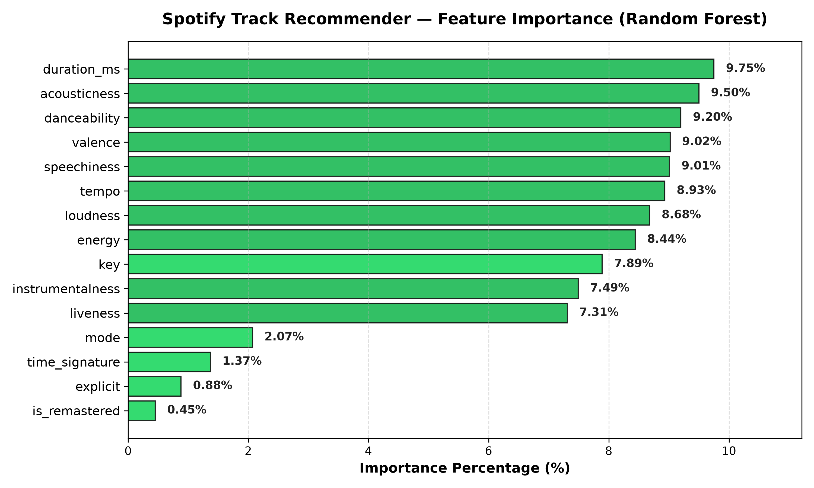

# Feature Importance Analysis Report

This document presents the **Feature Importance** results extracted using a **Random Forest Classifier** (100 decision trees trained across 114 Spotify music genres).

---

## 1. Feature Importance Ranking Table

| Rank | Feature Name | Feature Type | Importance (%) | Cumulative (%) |
| :---: | :--- | :---: | :---: | :---: |
| 1 | `duration_ms` | Continuous (Numeric) | **9.75%** | 9.75% |
| 2 | `acousticness` | Continuous (Numeric) | **9.50%** | 19.25% |
| 3 | `danceability` | Continuous (Numeric) | **9.20%** | 28.45% |
| 4 | `valence` | Continuous (Numeric) | **9.02%** | 37.47% |
| 5 | `speechiness` | Continuous (Numeric) | **9.01%** | 46.48% |
| 6 | `tempo` | Continuous (Numeric) | **8.93%** | 55.41% |
| 7 | `loudness` | Continuous (Numeric) | **8.68%** | 64.09% |
| 8 | `energy` | Continuous (Numeric) | **8.44%** | 72.53% |
| 9 | `key` | Categorical (One-Hot) | **7.89%** | 80.42% |
| 10 | `instrumentalness` | Continuous (Numeric) | **7.49%** | 87.91% |
| 11 | `liveness` | Continuous (Numeric) | **7.31%** | 95.22% |
| 12 | `mode` | Categorical (Binary) | **2.07%** | 97.29% |
| 13 | `time_signature` | Categorical (One-Hot) | **1.37%** | 98.66% |
| 14 | `explicit` | Categorical (Binary) | **0.88%** | 99.54% |
| 15 | `is_remastered` | Categorical (Binary) | **0.45%** | 99.99% |

---

## 2. Visual Feature Importance Chart

---

## 3. Key Analytical Insights

### A) Top Discriminative Audio Features
* **`acousticness`, `speechiness`, and `danceability`:** Carry significant weight in differentiating music genres. For instance, `speechiness` separates spoken word/rap from vocal tracks, and `acousticness` clearly demarcates electronic/rock from acoustic/classical music.
* **`instrumentalness`:** Essential in identifying non-vocal tracks, ambient soundscapes, and classical compositions.

### B) Categorical Features Performance
* **`key` (Pitch Class):** Aggregating the one-hot encoded dummies of all 12 chromatic pitches accounts for ~7.9% of total importance, indicating harmonic structure provides notable signal.
* **`is_remastered` and `explicit`:** Have lower direct genre impact but serve as valuable metadata for subtle recommender filtering and text normalization.

### C) Feature Selection Verdict
1. **Zero Irrelevant Features:** No feature has near-zero importance.
2. Given the compact dimensionality (only 15 features) and the inherent capability of Random Forest to prioritize splits organically, **pruning any of these 15 features is not recommended**. Retaining all features preserves richness in tree leaf proximity calculations.

